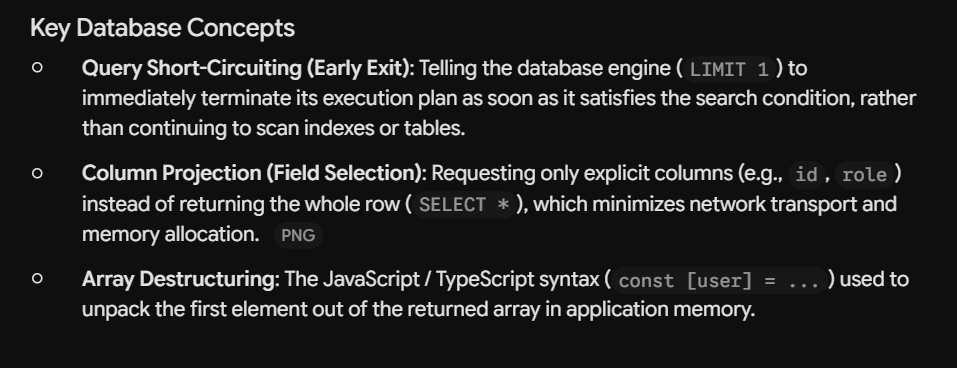

### Table Design Rules: Primary Key vs. Composite Unique

**1. Composite Primary Key** `primaryKey({ columns: [table.A, table.B] })`

* **What it is:** The combination of two foreign key columns acts as the main identifier. No `id` column is used.
* **When to use:** Pure **junction/linking tables** (e.g., `gameGenres`, `gamePlatforms`, `userWishlist`).
* **Why:**
* The record has no independent life—it only exists to connect two tables.
* No other table will ever create a foreign key pointing to a junction row.
* Prevents duplicate links automatically and saves database storage space.


---

**2. Surrogate ID + Composite Unique** `id: uuid()` + `unique().on(table.A, table.B)`

* **What it is:** The table has a standard single-column `id` (primary key), plus a rule enforcing that two specific columns can't repeat together.
* **When to use:** **Domain entities** or **data tables** that hold extra metadata or state (e.g., `gameSources`, `reviews`).
* **Why:**
* **Surrogate `id`:** Gives child tables a clean, single UUID to reference as a foreign key (e.g., `price_history` pointing to `source_id`).
* **Composite `unique()`:** Acts as a safety guard to stop duplicate records from being inserted by bug or duplicate API calls (e.g., stopping the same Steam store ID from being linked to a game twice).


---

### Key Takeaway for Notes

> * **Composite `primaryKey**` = Used for **relationships** (pure join tables with zero child tables).
> * **Surrogate `id` + Composite `unique()**` = Used for **entities** (tables that have their own data, endpoints, or child tables referencing them).
> 
<!-- ~~~~~~~~~~~~~~~~~~~~~~~~~~~~~~~~~~~~~ENDS HERE~~~~~~~~~~~~~~~~~~~~~~~~~~~~~~~~~~~~~~~~~~~~~~ -->


#BROWSER COOKIES

A cookie (also known as a web cookie or browser cookie) is a small piece of data a server sends to a user's web browser. The browser may store cookies, create new cookies, modify existing ones, and send them back to the same server with later requests.

Cookies are mainly used for three purposes:-
Session management: User sign-in status, shopping cart contents, game scores, or any other user session-related details that the server needs to remember.
Personalization: User preferences such as display language and UI theme.
Tracking: Recording and analyzing user behavior.

### Global Error Handling (`next(error)`)
* Passing caught exceptions to `next(error)` delegates error processing to a centralized Express error-handling middleware (`app.use((err, req, res, next) => ...)`).
* Eliminates boilerplate HTTP status handling across individual controller methods, standardizing response signatures for validation (`ZodError`), authorization, and database failures.

Without next(error): Every controller has to check if error is a Zod error, a DB error, or an auth error, and manually set .status(400), .status(401), or .status(500).

With next(error): Your controller code stays completely clean—just next(error). The centralized middleware handles status code mapping and formatting in one single place for your entire API.

#Query Short-Circuiting



---

## Crucial Interview Questions & Answers (Project-Specific)

### Q1: Why denormalize `averageRating`, `ratingsCount`, and `reviewsCount` on the `games` table instead of calculating them dynamically via `COUNT()` and `AVG()`?

* **The Problem with Dynamic Calculation:**
  In endpoints like `getTopGames` or paginated catalog browsing, computing ratings on the fly requires:
  ```sql
  SELECT games.*, AVG(r.rating) AS avg_rating, COUNT(r.game_id) AS total_ratings
  FROM games
  LEFT JOIN user_game_ratings r ON games.id = r.game_id
  WHERE games.status = 'released'
  GROUP BY games.id
  ORDER BY avg_rating DESC, total_ratings DESC
  LIMIT 20;
  ```
  This forces PostgreSQL to perform heavy hash joins and aggregate scans across hundreds of thousands of rating records on **every single request**, causing severe CPU and disk I/O bottlenecks.

* **Why Denormalization Wins in GameBoxd (Read-Heavy Architecture):**
  GameBoxd is heavily read-dominant (~95%+ reads vs. writes). Games are browsed thousands of times for every single rating submitted. Denormalizing `averageRating`, `ratingsCount`, and `reviewsCount` directly onto the `games` table enables:
  1. Instant $O(\log N)$ indexed lookups and sorting without touching child tables (`orderBy: [desc(games.averageRating), desc(games.ratingsCount)]`).
  2. Sub-millisecond response times for top-rated, latest, and paginated game feeds.

* **How Consistency is Managed:**
  The write cost is shifted away from the read path:
  - On rating creation/update/deletion, the counters are updated atomically in the database (or deferred via background job/queue like BullMQ/Redis).
  - This guarantees blazing-fast catalog reads while keeping writes isolated and predictable.

---

### Q2: Why use composite indexes like `(game_id, created_at)` on `reviews` instead of two separate single-column indexes?


* **The Query Pattern in GameBoxd:**
  Reviews for a game are almost always fetched paginated and ordered by time:
  ```sql
  SELECT * FROM reviews 
  WHERE game_id = $1 
  ORDER BY created_at DESC 
  LIMIT 20 OFFSET 0;
  ```

* **Single-Column Indexes vs. Composite B-Tree Index:**
  * **With separate single indexes (`game_id` index & `created_at` index):**
    The database engine can only pick one index effectively (or do a Bitmap Index Scan). It finds all reviews matching `game_id`, loads the records into working memory (`work_mem`), and performs an expensive in-memory sort (`Top-N Sort` node in `EXPLAIN ANALYZE`) on `created_at`. As reviews grow, this sort becomes a major memory and latency bottleneck.
  * **With composite index `(game_id, created_at)`:**
    In a B-Tree index with multiple columns, records are physically ordered first by `game_id`, and within each `game_id`, sorted by `created_at`. PostgreSQL jumps directly to the matching `game_id` branch and scans the index leaf nodes already in sorted chronological order. It satisfies **both the `WHERE` filter and the `ORDER BY` clause in a single operation**, completely avoiding an in-memory sort step.

### Zod Schema vs. Inferred Type (`z.infer`)

| Feature | `createPlatformSchema` (Zod Schema) | `CreatePlatformInput` (Inferred Type) |
| :--- | :--- | :--- |
| **Stage** | **Runtime** (When server is running) | **Compile-Time** (While writing code) |
| **Type** | JavaScript Object | Static TypeScript Type |
| **Purpose** | Validates incoming `req.body` payloads and blocks invalid HTTP requests | Provides VS Code autocompletion and catches code errors before running |
| **Usage** | `createPlatformSchema.parse(req.body)` | `const createPlatform = (data: CreatePlatformInput) => ...` |

> **Key Takeaway:** Use the **Zod Schema** to protect your server from invalid user inputs, and use the **Inferred Type** (`z.infer`) to maintain strict type safety across your controllers, services, and repositories without manually duplicating interfaces.

# Lesson: `.for("update")` in Drizzle ORM

## 1. What is `.for("update")`?

`.for("update")` is a Drizzle ORM method that generates PostgreSQL's `SELECT ... FOR UPDATE` statement.

It **locks selected database rows until the current transaction finishes**.

**Important:** Despite its name, `.for("update")` does not update any data. It only locks rows to coordinate concurrent database operations.

## 2. Why do we need it?

Imagine two users rate Elden Ring at the same time:

- User A gives 5 stars.
- User B gives 4 stars.

Both requests must save their ratings and recalculate the game's `averageRating` and `ratingsCount`.

If these operations run concurrently without proper coordination, one transaction might overwrite statistics calculated by another transaction.

We use `.for("update")` to make these transactions take turns when updating the same game's statistics.

## 3. Example from GameboxD

```ts
const [game] = await tx
  .select({
    id: games.id,
    slug: games.slug,
  })
  .from(games)
  .where(eq(games.id, gameId))
  .for("update");

if (!game) return null;
```

### Explanation

- `tx.select()` — Selects data using the current transaction.
- `id: games.id` — Retrieves the game's ID.
- `slug: games.slug` — Retrieves the game's slug.
- `.from(games)` — Reads from the `games` table.
- `.where(eq(games.id, gameId))` — Selects the requested game.
- `.for("update")` — Locks that game's row until the transaction commits or rolls back.

This query locks only the matching row in the `games` table, not the entire table or the individual rows in `user_game_ratings`.

## 4. How does the lock work?

Suppose User A and User B rate the same game simultaneously.

**Transaction A:**
1. Selects Elden Ring using `.for("update")`.
2. Acquires a lock on Elden Ring's row.
3. Inserts or updates User A's rating.
4. Recalculates the average rating.
5. Commits the transaction and releases the lock.

**Transaction B:**
1. Tries to select Elden Ring using `.for("update")`.
2. Waits because Transaction A holds a conflicting lock.
3. Acquires the lock after Transaction A commits.
4. Saves User B's rating.
5. Recalculates statistics using the latest committed changes.
6. Commits and releases the lock.

This helps ensure the game's final statistics reflect both ratings.

## 5. Why lock the `games` row instead of the `user_game_ratings` row?

Each user has their own rating row, but multiple users affect the same game's statistics.

For example:

| userId | gameId | rating |
|---|---|---|
| user-A | game-1 | 5.0 |
| user-B | game-1 | 4.0 |

Both ratings affect these fields in the `games` table:

```ts
averageRating
ratingsCount
```

We lock the game's row because it is the shared resource.

**Note:** This works when all operations that modify the same game's rating statistics follow the same locking convention.

## 6. `.for("update")` vs `.update()`

These are different operations.

### `.for("update")` — Locks a row

```ts
const [game] = await tx
  .select()
  .from(games)
  .where(eq(games.id, gameId))
  .for("update");
```

This does not change any data.

### `.update()` — Modifies a row

```ts
await tx
  .update(games)
  .set({ ratingsCount: 12 })
  .where(eq(games.id, gameId));
```

This actually changes the `ratingsCount` value.

## 7. Why use `tx.select()` instead of `db.select()`?

We are working inside a transaction:

```ts
await